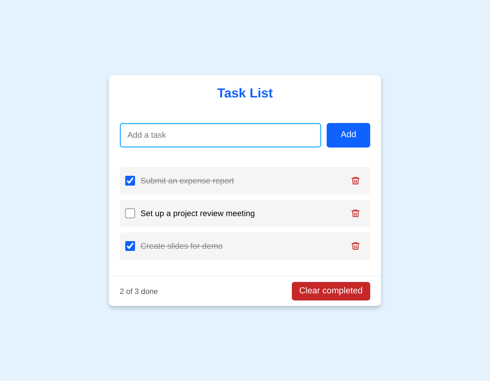
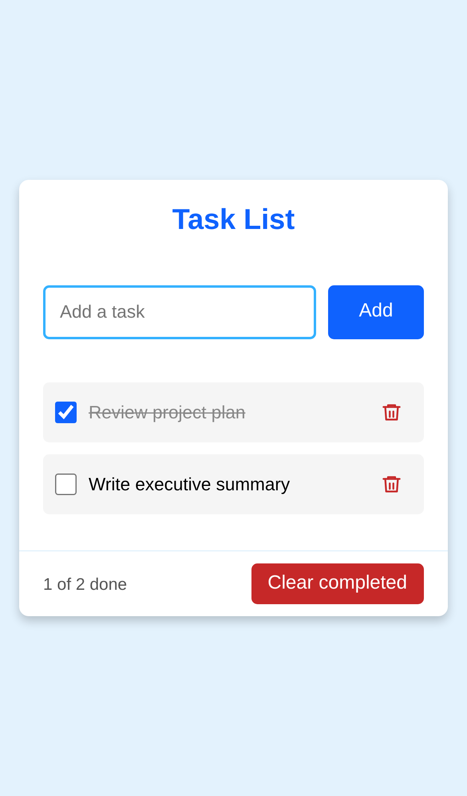

<div align="center">

# ✅ Task List

**A clean, responsive to-do list built with plain HTML, CSS and JavaScript. Your tasks are saved in your browser, so they're still there when you come back.**

[**▶ Try it live**](https://muneermiller.github.io/Task-List-Application/)




</div>

## About

I built this as the final project for **IBM SkillsBuild Web Development Fundamentals**. The brief was a task list that follows a set of [requirements](docs/requirements.md) and a [wireframe](docs/wireframe.png), and that works on desktop and mobile.

## Features

- **Add tasks** with the Enter key or the Add button. Empty tasks get a clear error message under the box instead of a pop-up.
- **Tick tasks off.** Completed tasks are struck through, and a counter shows how many are done.
- **Delete a task** with its bin button, or **clear all completed tasks** at once.
- **Saved automatically** in your browser's `localStorage`, so your list survives a refresh. If storage is blocked, for example in some private windows, the app still works for that visit.
- **Works on any screen.** The layout fits phones without sideways scrolling, and long lists scroll inside the card.
- **Accessible.** Every control is a real button or form field, so it works with the keyboard and screen readers. Focus is clearly visible, and animations are switched off for people who prefer reduced motion.
- **Safe with any text.** Tasks are inserted as text, so typing something like `<b>hi</b>` shows exactly that and never runs as HTML.

<p align="center">
  
</p>

## Run it locally

There's nothing to install or build.

```bash
git clone https://github.com/MuneerMiller/Task-List-Application.git
```

Then open `index.html` in your browser.

## How it works

All the tasks live in one array of `{ id, name, done }` objects. Every change (adding, ticking, deleting or clearing) updates that array, saves it to `localStorage` and calls `render()`, which rebuilds the list from the array. Keeping one source of truth means the page, the counter and the saved copy can never disagree.

```
Task-List-Application/
├── index.html               # Page structure
├── assets/
│   ├── styles/style.css     # Layout, colours and animations
│   └── js/script.js         # Task state, saving and rendering
└── docs/
    ├── requirements.md      # The project brief
    ├── wireframe.png        # The design it was built from
    └── screenshot-*.png     # Images for this README
```

## Licence

Copyright © 2026 Mogamat Muneer Miller. All rights reserved. The code is public so you can read it and learn from it, but it is not open source. See [LICENSE](LICENSE).

## Contact

Built by **[Muneer Miller](https://github.com/MuneerMiller)** · [muneermiller.github.io](https://muneermiller.github.io/)
